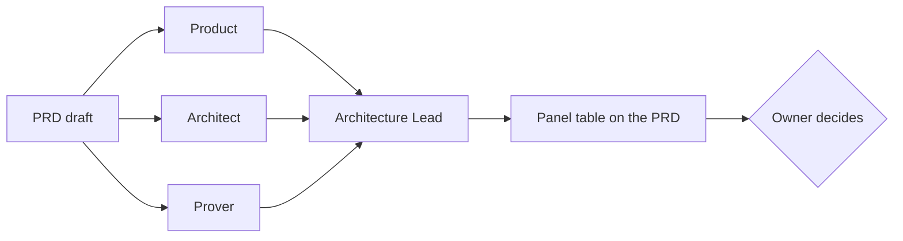
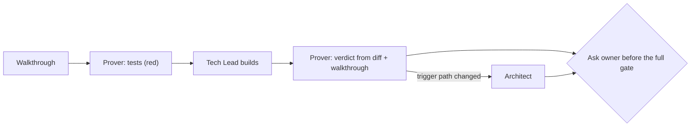

# How the team works

This is the operating manual: what HarteBurn optimises for, when each role joins, in what order, who decides, what "done" means, and what the owner sees. The same text, condensed, is put into every session at start ([`ethos.md`](../ethos.md)), so no one has to ask for it.

## The outcomes, in order when they conflict

1. **Highest quality, proven never believed.** Engineering, code and execution are proven by a test, a red run and, for anything a person sees, a look at the page. A claim without evidence is not a result.
2. **Speed.** A decision is one question with an example per side. A build is a slice. A disagreement that changes neither the page nor where data lives is settled by precedence, not debate. Minutiae never reach the owner.
3. **No borrowed debt.** Take the smallest complete fix; a bigger structural fix is sized beside it and Product triages it, never built by default (retro 2026-10-21). A workaround needs the owner's dated approval and a row that names the debt.
4. **Innovation without novelty.** Prefer the proven pattern and the mechanisms the product already has; never invent a second one. When a role finds a genuinely better way, it may **challenge the architecture**. The Architect writes *extends* with the exact page edit, and the Architecture Lead frames one question for the owner, headed `Reopens <date>: <decision>`, with an example per side. A dated decision reopens only this way, and only once.

## When a role is convened

A role is convened when the thing being changed is **in its domain**, never because the work feels big. When triggers overlap, **a trigger that convenes beats one that excuses**. A one-word label bug has an obvious cause and also changes a customer-facing word, so Product runs, for one line.

| Trigger | Brief | Prover | Architect | Product | Designer | Security | Architecture Lead |
|---|---|---|---|---|---|---|---|
| Any session, any role | always present | | | | | | |
| Any code change | | always | | | | | |
| A PRD before the owner approves it | | derives the tests from the walkthrough | current state and design | walkthrough and use cases | when it changes anything a person sees | | always |
| A diff touches a load-bearing path the brief names (models, migrations, routes, the boundary with another service, deployment, an architecture page) | | | yes | | | | if the Architect says *extends* or *violates* |
| A diff changes a word or screen a customer or vendor sees | | | | yes | yes | | |
| A change to anything a person sees, admin screens included (jg 2026-10-27) | | | | | consult; a full pass for a new screen, a new visible feature or a design-system change | | |
| A diff touches the project's security domain (log in, permissions, customer data, a public endpoint, secrets, a dependency, outbound calls, an AI feature's inputs) (jg 2026-10-28) | | | | | | yes, before the gate; abuse cases at Frame | |
| Two roles disagree across domains | | | | | | | yes |
| Docs only, a dependency bump, or a bug with no trigger path and no customer word | | yes, if any code | no | no | no | a dependency bump: yes | no |
| Money, release, branch, another repo, production data, reopening a decision | **the owner only**; no role decides these | | | | | | |

The Tech Lead names which roles it convened, and which it excused and why, on the **first line** of every checklist. A ledger hook records every dispatch inside `.git/harteburn/ledger.jsonl`, so that line can be checked against what actually ran.

## The loop: every objective (0.5.0, from the first retro)

Agile without the bookkeeping. Each beat is timeboxed; the Tech Lead (the main session) owns flow.

| Beat | Who | Timebox | What it produces |
|---|---|---|---|
| **Frame** (`/frame`) | Product + Tech Lead | 10 min | The objective in production terms, with numbers (time, cost, what the persona sees). Product rejects what the product would reject. Each Done line lists its items, a write-end row for each item that moves data (every field the destination requires, and its source), and where it is proven (production, canary or stub). Every open Change from earlier retros joins the checklist. |
| **Ready** | Tech Lead (+ Architect for new infrastructure) | 15 min; 60 min when the record names `providers` | A full production snapshot of the rows involved; production-latency numbers per step; a rehearsal plan for new infrastructure; the Architect's rules-hold check on the touched paths. A new provider: one real sign-in, list and write, each a `live_reads` row with its resource and reply shape, before Slices prices a piece; the write goes only to an account the owner names first by sending, alone, `test account <provider>: <account>` |
| **Slices** | Tech Lead (+ Lead's price for any bundle) | 5 min | Numbered pieces 1..N, each with its production check, a price in build minutes and a timebox, frozen (a piece added later needs the owner's dated go and says what it delays: `"holds_back": "<what> by ~N h"`); the quick win ships first, alone; the Prover returns any Done line that cannot pass in this objective |
| **Build + prove** | Prover tests first; Tech Lead builds; one proof pass per slice | per piece | A find joins only inside the piece it blocks, or as a new piece by the owner's dated go; otherwise it goes on a named, priced list (Product's triage). Each find is tagged `regression of this diff? y/n`; a `y` or a `mistake` is fixed inside its piece, never dropped or blocked. A first `/prove after` needs `--readers <file>` or `--no-new-outcome "<why>"`. The builder breaks its own guards and lists their escapes first; guard removal only on guards that log does not cover, in the Prover's warm worktree, with a timeout; every survivor in one pass; the Architect runs in the same message as the Prover; a pass takes 8 minutes or less. A second dispel of one step goes to the Lead (≤ 5 min ruling), never a third automatic round |
| **Done review** (`/done`) | Product, in production | 10 min | Done, or not done and why, against the Frame's numbers. A green gate is not done |
| **Retro** (`/retro`) | Tech Lead, with the owner | 10 min | In `retros/`: lean (one page) by default, full (built from each role's own evaluation, written blind) or dismissed, **the owner's (or Product's) call**. The owner **ratifies** each Change (yes / no / modify) and every yes is built in the same session as a mechanism, not prose. **An objective is closed when its Done verdict and its retro (or dismissal) are filed** |

**Handoff** (`/handoff`, 0.7.0): every call re-reads the whole conversation, so a long one costs
the most (measured: late calls ~10× early ones).
- When the reminder hook reports context past the threshold (500k tokens by default since 0.7.1,
  `HARTEBURN_HANDOFF_TOKENS`), or an objective closes, the Tech Lead hands off at the next checkpoint.
- It brings the board and memory current, writes `.harteburn/handoff.md`, and shows it in chat.
- The owner types **`/clear`, then `go`**, in the same window; the session hook loads the handoff
  once. A new window and `go` works the same. The old conversation stays reachable with `/resume`
  (jg, 2026-10-30, reopening 2026-10-15: they answer from a phone and cannot open a new session there).
- Never compact.

**Flow:**
- At every checkpoint the Tech Lead answers: on the objective? what waits on what? can something
  ship now?
- Past 2× a timebox, a one-line replan goes to the owner; a piece past 2× stops for the owner's
  cut-or-continue.
- The board refuses a record it cannot show truly (0.15.0): `board-md.mjs` exits 1 and the reminder
  says so each prompt, until it is put right.

**Visibility:** the checklist is organised by beat, with time against each timebox, in chat and on a
live page. It is updated at every beat change, agent dispatch/return and gate, and never more than
10 minutes without an update.

The sections below describe each role's order inside Build + prove.

## The order of operations

The brief is in place before anything starts.

### A PRD: parallel, then reconciled



`/prd-panel <prd>` runs this. The reviewers (three, and the Designer when the PRD changes anything a person sees) run **in parallel and blind**: none sees another's output or the Tech Lead's view. Each gets the PRD path and the PRD's dated decisions marked as fixed. The Lead then reconciles them, and the Tech Lead puts the Lead's table at the top of the PRD. Sequential review happens only with a stated reason, named on the checklist.

### A slice: the Prover first and last



`/prove <prd> before` gives the failing tests. `/prove <prd> after` gives the verdict. Product joins only if a customer-facing word or screen changed.

### A bug

Prover's red test → fix → green, and red again once the guard is removed → Product, in one line, only if a customer-facing word changed.

## Who decides

**Each role wins in its domain:**

| Domain | Wins |
|---|---|
| Whether it is done and testable | Prover |
| Where data lives and who calls whom | Architect |
| What the customer sees and reads | Product |
| Across domains | Architecture Lead, who says why; the losing view stays visible |

**The owner decides**, always, as one question with an example per side:
- a feature decision
- anything with revenue or customer impact
- money, a release, a branch, edits to another repo, production data
- reopening a dated decision
- a change to what something means to a customer
- a cross-domain split the Lead cannot settle with one example per side
- the Prover says *dispelled* and the builder disagrees

Everything else is decided in the thread and shown on the checklist.

## The rules every role follows

- **Pass material, never conclusions.** Roles get files, diffs and PRDs. The Prover's prompt is built by a script.
- **The repo's docs win** over HarteBurn's general way of working: its house rules, its PRD standards, its brief.
- **The code beats the architecture pages, and the pages beat the brief.** Cite `file:line`.
- **Dated decisions are fixed** unless reopened through the innovation path.
- **Name the party:** provider, vendor, or the vendor's customer. Never a bare "customer".
- **Never run the full gate, push, or commit** from a role. The Tech Lead does, after asking the owner where the repo requires it.

## Definition of done

**An objective is done when Product's Done review, in production, says the Frame's numbers are met,
and closed when its retro (full, lean or a one-line dismissal: the owner's call) is filed.** The per-slice and per-PRD conditions below are necessary,
not sufficient.

**A slice is done when:**
- tests derived from the walkthrough were red before the change and green after
- one guard was removed and seen red
- the Prover says **proven**, from the diff and walkthrough alone
- the Architect says **conforms**, or the architecture page was updated in the same change
- the brief is current, and the pages gate passes: code on the repo's page map changed with one of its pages, or the commit that changed it says `Pages-unchanged: <why>`
- for a screen a vendor or a vendor's customer sees, Product named its help topics, and they are true
- a piece whose diff changes a security-domain path (the house rules' table) has a `harteburn:security` verdict that covers it, **holds**, or the owner's own `accept piece <n>: <the finding>`, sent alone in one message. Commit first, then dispatch Security with exactly the prompt the command in the board's refusal prints (`node <plugin>/scripts/board-security.mjs --prompt <the piece's start> HEAD`, with the record and piece when there are open refusals): copy it as printed. The board reads the verdict from the run's transcript and refuses Done without it, and a narrowed prompt does not count
- each find tagged `regression of this diff? y/n`; a `y` or a `mistake` was fixed in its piece, never dropped
- on a Team license: a Done-line or scope change has the product owner's `go piece n:`, an architecture-doc change the architecture owner's, and a risk accept is the security owner's (only theirs counts, on the board and at the push gate); see [Team seats](roles.md#team-seats)
- the owner was asked before the full gate

**A PRD is done when:**
- the walkthrough meets the repo's standard
- three blind reviews and a reconciliation are saved in `docs/reviews/`
- the panel table is at the top of the PRD
- every decision on it is answered and dated by the owner

## What the owner sees: the HarteBurn checklist

One checklist per objective, grouped by outcome, one line per item. Each role's conclusion gets its own line. The first line always names who ran.

```
HarteBurn — convened: Prover, Architect · excused: Product (no customer-facing word changed)
Customer gets the value
- [x] Product (PRD panel): the walkthrough reads as the vendor's customer would say it
Fits the architecture
- [x] Architect: conforms — trigger: a new migration; no page edit needed
Proven done
- [x] Prover: 3 tests from walkthrough step 0.2 red → green; guard removed → red
- [ ] Prover: looked at the page ← here
Decisions (owner)
- [ ] none reopened · one question: Architect vs Product on X, with an example each side
Gates
- [ ] brief current · [ ] ask the owner before the full gate · [ ] commit
```

The long forms stay in `docs/reviews/<id>-<date>-<role>.md`, out of the owner's way.

## Guidance versus enforcement

Be honest about which is which:

| Mechanically enforced | Guidance (the charters and the way of working) |
|---|---|
| The brief is in every session and agent (hooks) | The convene rule |
| The brief is current, complete and fits (gate) | Precedence and the owner's list |
| The Prover's prompt holds only the walkthrough and the diff (`/prove`'s script) | The order of operations |
| Every dispatch is recorded (ledger) | The checklist format |
| A done piece that changed a security-domain path has a Security verdict covering it (the board) | |
| An agent's push has a covering Security holds and Prover proven (the push gate, 0.26.0) | |
| A regression of this diff cannot be dropped or blocked (the board) | |
| On a Team license, the right seat signs off: the product owner's go for a Done-line or scope change, the architecture owner's for an architecture change, the security owner's accept (the board, and the push gate for the accept) | |

The push gate is that next step. On 2026-10-31 a session in another repo pushed this one before its Prover and Security verdicts, so an agent's push now needs both, covering what it pushes. Git's own pre-push hook checks the same, in the owner's terminal too; the owner's way past is a self-typed `git push --no-verify`. Once a repo is held it stays held; to let one go, see [Turn it off or remove it](install.md#turn-it-off-or-remove-it). A commit is still not refused: the push is where the work leaves the machine.
